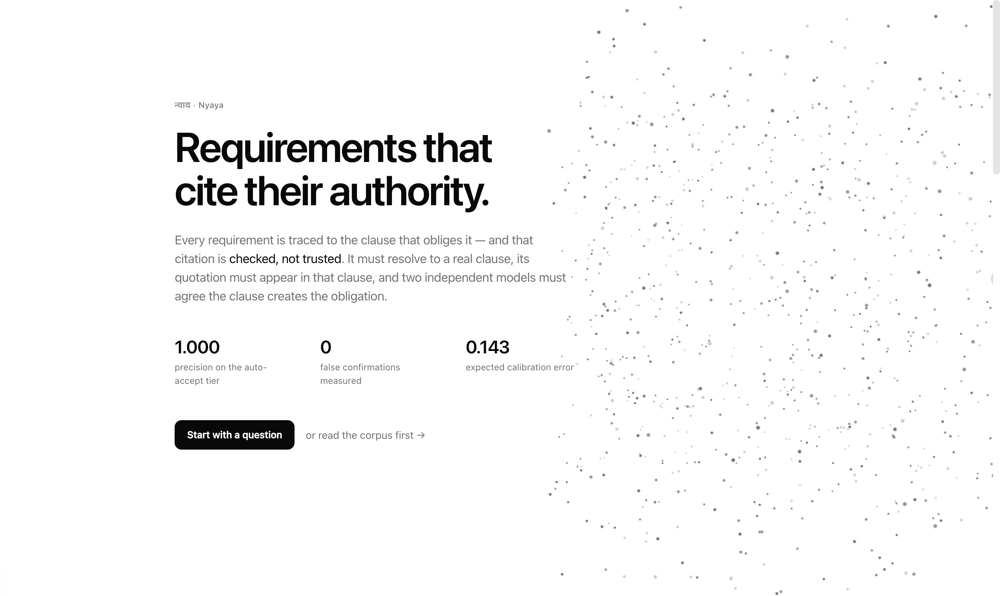
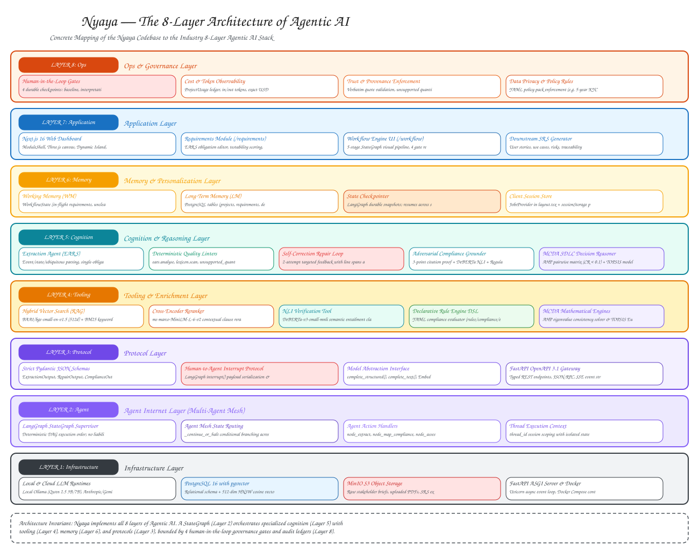
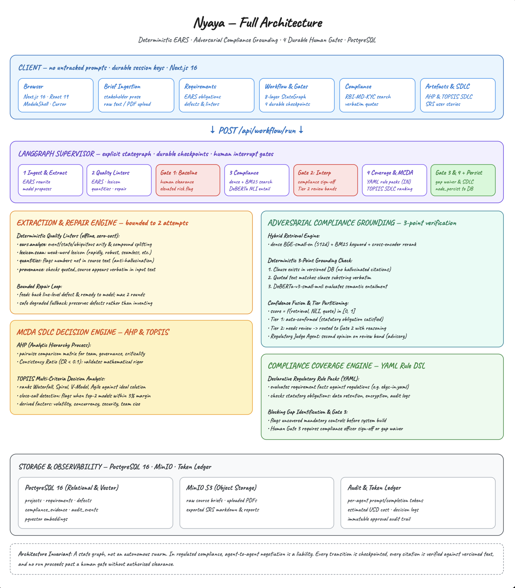

<div align="center">

# Nyaya (न्याय)
### Regulatory-Grade Agentic Requirements Engineering, Compliance Grounding & SDLC Decision Engine

[](LICENSE)
[](https://python.org)
[](https://fastapi.tiangolo.com)
[](https://nextjs.org)
[](https://www.postgresql.org)

<p align="center">
  <b>Traceable, provably grounded requirements engineering for regulated financial institutions.</b><br>
  Strict EARS formatting • Adversarial citation verification • 4 Durable human-in-the-loop governance gates • Mathematical AHP & TOPSIS SDLC selection.
</p>

</div>

---

<p align="center">
  
</p>

---

## 🏛️ Philosophy & Core Premise

In Sanskrit epistemology, **Nyaya (न्याय)** is the school of logic concerned with *pramāṇa* — the valid means of acquiring knowledge, and what counts as admissible evidence for a claim.

In regulated banking software (e.g., eKYC customer onboarding, RBI Master Directions, DPDP Act 2023, PMLA), **autonomous multi-agent negotiation swarms are an unacceptable regulatory liability**. If agents can debate and silently compromise on security thresholds or data retention periods, the system cannot be audited or certified.

**Nyaya enforces strict epistemological rigor:**
- **No Unchecked Generation**: LLMs propose structured requirements and legal citations; deterministic linters and cross-encoders verify them.
- **Explicit StateGraph DAG**: The orchestrator is a predictable state machine checkpointed in PostgreSQL — never an unconstrained swarm.
- **Mandatory Human Governance**: Four durable interrupt gates (`requirement_baseline`, `regulatory_interpretation`, `compliance_gap`, `sdlc_selection`) halt execution until authorized stakeholders sign off.
- **Mathematical Decision Making**: Software lifecycle (SDLC) selection uses mathematical Multi-Criteria Decision Analysis (AHP with Consistency Ratio $CR < 0.10$ and TOPSIS Euclidean ranking), rather than LLM intuition.

---

## 📐 The 8-Layer Architecture of Agentic AI

Nyaya is architected in direct alignment with the industry-standard **8-Layer Architecture of Agentic AI**:

<p align="center">
  
</p>

### Concrete Mapping of Nyaya to the 8 Layers:

| Layer | Standard Architecture (Coquillo Framework) | Concrete Nyaya Implementation & Source Files |
| :--- | :--- | :--- |
| **Layer 8: Ops & Governance** | Deployment pipelines, cost optimization, observability, policy engines, audit ledgers, trust frameworks | • **Human Approval Gates**: 4 durable checkpoints (`requirement_baseline`, `regulatory_interpretation`, `compliance_gap`, `sdlc_selection`) in [`nyaya/graph/gates.py`](nyaya/graph/gates.py)<br>• **Role Competence**: Role-based signing authority (`Compliance`, `Legal`, `Product Owner`, `Architect`)<br>• **Audit Ledger**: `WorkflowApproval` and `RunAudit` models in [`nyaya/db/models.py`](nyaya/db/models.py)<br>• **Cost Tracking**: In/out token counts and USD cost tracking in [`nyaya/llm/client.py`](nyaya/llm/client.py)<br>• **Policy Packs**: Declarative YAML compliance packs in [`rules/compliance/`](rules/compliance/) |
| **Layer 7: Application** | Personal assistants, creation tools, research agents, document agents, UI dashboards | • **Next.js 16 Glassmorphic UI**: [`web/src/app/`](web/src/app/) with React 19 and Three.js canvas<br>• **Requirements Module** (`/requirements`): EARS editor, ambiguity linter, defect repair<br>• **Workflow Module** (`/workflow`): StateGraph execution viewer and gate approval modal<br>• **Compliance Module** (`/compliance`): Clause hybrid search and citation verifier<br>• **SDLC Module** (`/sdlc`): AHP pairwise matrix and TOPSIS ranking explorer<br>• **SRS Generator** (`/artefacts`): IEEE 830 / ISO 29148 specification export |
| **Layer 6: Memory & Personalization** | Working memory, long-term memory, identity module, conversation & goal history | • **Working Memory (WM)**: In-flight `WorkflowState` dictionary in [`nyaya/graph/state.py`](nyaya/graph/state.py)<br>• **Long-Term Memory (LM)**: PostgreSQL relational models (`Project`, `Requirement`, `ComplianceMapping`, `Clause`)<br>• **State Checkpointer**: LangGraph durable snapshots surviving process restarts<br>• **Client Session State**: Local session persistence via React Context (`JobsProvider`) |
| **Layer 5: Cognition & Reasoning** | Planning, reasoning engines, error handling, self-improvement, multi-step task handling | • **Extraction Agent**: EARS pattern decomposition in [`nyaya/agents/extraction.py`](nyaya/agents/extraction.py)<br>• **Self-Correction Feedback Loop**: Bounded 2-pass repair loop feeding linter defects back to LLM<br>• **Compliance Mapping Agent**: Statutory reasoning in [`nyaya/agents/compliance.py`](nyaya/agents/compliance.py)<br>• **Regulatory Judge Agent**: Multi-statute conflict adjudication in [`nyaya/agents/judge.py`](nyaya/agents/judge.py)<br>• **Mathematical Reasoning**: AHP & TOPSIS decision analysis in [`nyaya/mcda/`](nyaya/mcda/) |
| **Layer 4: Tooling & Enrichment** | RAG, vector databases, external tools, function calling, code sandboxes, knowledge bases | • **Hybrid RAG**: pgvector semantic cosine similarity + BM25 keyword matching in [`nyaya/retrieval/service.py`](nyaya/retrieval/service.py)<br>• **Quality Critic Linters**: Deterministic EARS parser, ISO 29148 lexicon scanner, quantities validator in [`nyaya/agents/quality/`](nyaya/agents/quality/)<br>• **Adversarial NLI Verifier**: DeBERTa-v3 cross-encoder entailment in [`nyaya/rules/tiered.py`](nyaya/rules/tiered.py)<br>• **Rule Engine**: Deterministic YAML pack evaluation in [`nyaya/rules/engine.py`](nyaya/rules/engine.py) |
| **Layer 3: Protocol** | Agent-to-Agent protocols, MCP, function call protocol, typed data contracts | • **Strict Data Contracts**: Pydantic v2 schemas (`ExtractionResult`, `ExtractedRequirementItem`, `ComplianceMappingResult`) in [`nyaya/agents/schemas.py`](nyaya/agents/schemas.py)<br>• **Gate Protocol**: `interrupt(payload(...))` envelope in [`nyaya/graph/gates.py`](nyaya/graph/gates.py)<br>• **API Protocol**: OpenAPI 3.1 typed REST endpoints in [`nyaya/api/routers/`](nyaya/api/routers/) |
| **Layer 2: Agent Internet / Mesh** | Multi-agent systems, communication protocols, agent mesh, state handoffs | • **StateGraph DAG Supervisor**: Explicit transition graph in [`nyaya/graph/workflow.py`](nyaya/graph/workflow.py)<br>• **Sequential State Passing**: Strongly-typed `WorkflowState` passed immutably between nodes<br>• **Durable Gate Resumption**: Asynchronous gate resume with role authorization in [`nyaya/graph/runner.py`](nyaya/graph/runner.py) |
| **Layer 1: Infrastructure** | APIs, HTTP/WebSockets, GPUs/TPUs, data lakes, databases, object storage | • **Relational & Vector DB**: PostgreSQL 16 with `pgvector` extension (`nyaya-postgres`)<br>• **Object Storage**: MinIO S3-compatible blob storage (`nyaya-minio`) for raw PDFs and SRS files<br>• **ASGI Application Server**: FastAPI + Uvicorn async Python server in [`nyaya/api/app.py`](nyaya/api/app.py)<br>• **Containerization**: `docker-compose.yml` local infrastructure stack |

---

## 🏗️ End-to-End System Architecture

<p align="center">
  
</p>

---

## ⚡ Stack

Here is how each piece of the stack earns its place:

### Reasoning & Cognition
Requirements decomposition and regulatory alignment require high-precision structured extraction, so we decouple creative generation from deterministic linting.

[](#)
[](#)
[](#)
[](#)
[](#)

### Orchestration & Governance
Autonomous agent negotiation is an audit liability in regulated banking; execution follows an explicit stategraph DAG checkpointed durably into PostgreSQL.

[](#)
[](#)
[](#)
[](#)

### Grounding & Retrieval
Models propose legal citations, but zero-trust deterministic code validates them: the clause must exist in DB, match verbatim as a substring, and pass semantic entailment.

[](#)
[](#)
[](#)
[](#)

### Decision & Lifecycle (MCDA)
Software lifecycle methodology cannot be left to an LLM's intuition; it is derived through objective multi-criteria mathematical optimization.

[-0c8599?style=for-the-badge)](#)
[](#)
[](#)

### Frontend & Infrastructure
Minimal client state, real-time glassmorphic dashboard, and containerized deployment for air-gapped financial infrastructure.

[](#)
[](#)
[](#)
[](#)
[](#)

---

## 🔄 The 5-Stage Verification Workflow

In [`nyaya/graph/workflow.py`](nyaya/graph/workflow.py), the execution pipeline runs 5 computational stages separated by 4 durable human verification gates:

```
[START]
   │
   ▼
[Stage 1: node_extract] ────────► LLM structured extraction + EARS/Lexicon/Quantities linters
   │
   ▼
[Gate 1: baseline_gate] ────────► DURABLE INTERRUPT: Product Owner approves baseline & defects
   │ (rejection halts run)
   ▼
[Stage 2: node_map_compliance] ─► Hybrid RAG + LLM mapping proposal + 3-tier NLI grounding
   │
   ▼
[Gate 2: interpretation_gate] ──► DURABLE INTERRUPT: Compliance / Legal signs off on citations
   │ (rejection halts run)
   ▼
[Stage 3: node_assess_coverage] ─► Deterministic YAML rule pack evaluation (eKYC-IN gaps)
   │
   ▼
[Gate 3: gap_gate] ─────────────► DURABLE INTERRUPT: Compliance / Risk clears or waives gaps
   │ (rejection halts run)
   ▼
[Stage 4: node_recommend_sdlc] ──► Derives 7 factors + AHP matrix (CR < 0.10) + TOPSIS ranking
   │
   ▼
[Gate 4: sdlc_gate] ────────────► DURABLE INTERRUPT: Software Architect approves SDLC model
   │ (rejection halts run)
   ▼
[Stage 5: node_persist] ────────► Transactional commit of requirements, mappings & audit trail to PostgreSQL
   │
   ▼
 [END]
```

### The 4 Human Governance Gates:
1. **Requirement Baseline Gate** (`requirement_baseline`):
   - *Competent Roles*: Product Owner, Business Analyst.
   - *Action*: Inspects total requirement count, untestable requirements, elevated risk items, and flagged ambiguities before downstream work begins.
2. **Regulatory Interpretation Gate** (`regulatory_interpretation`):
   - *Competent Roles*: Compliance Officer, Legal Counsel.
   - *Action*: Reviews Tier 2 citations, unconfirmed statutory interpretations, and cross-regulatory contradictions.
3. **Compliance Gap Gate** (`compliance_gap`):
   - *Competent Roles*: Compliance Officer, Risk Manager.
   - *Action*: Reviews blocking gaps identified against mandatory rule packs (e.g., 5-year KYC record retention). Must formally resolve or sign a waiver.
4. **SDLC Selection Gate** (`sdlc_selection`):
   - *Competent Roles*: Software Architect, Engineering Lead.
   - *Action*: Reviews mathematical AHP/TOPSIS recommendation, consistency ratio, and sensitivity notes before committing engineering teams.

---

## 🤖 Specialized Agents & Engines

### 1. Extraction Agent (`nyaya/agents/extraction.py`)
- **Input**: Unstructured stakeholder prose, RFP excerpts, regulatory briefs.
- **Cognitive Logic**: Extracts atomic, single-obligation requirements formatted in **EARS** (Easy Approach to Requirements Syntax: *Ubiquitous*, *Event-driven*, *State-driven*, *Unwanted behaviour*, *Optional feature*).
- **Quality Critic Loop**: Passes requirements through deterministic linters:
  - `EARSValidator`: Checks syntactic conformance to EARS templates.
  - `VagueLexiconLinter`: Flags ambiguous words from ISO/IEC/IEEE 29148 (*fast*, *seamless*, *appropriate*).
  - `QuantityValidator`: Ensures quantitative thresholds specify units (`ms`, `sec`, `%`, `INR`) and error bounds.
  - `ConsistencyChecker`: Detects conflicting requirement pairs.
- **Self-Repair**: Runs up to 2 targeted LLM reflection passes with exact line-level linter feedback before freezing the baseline.

### 2. Compliance Mapping Agent (`nyaya/agents/compliance.py`)
- **Input**: Baselined requirements, target domain (`ekyc_onboarding`), target jurisdictions (`IN`).
- **Retrieval Engine**: Hybrid dense semantic search (`pgvector` with cosine similarity) + lexical BM25 over clause-chunked statutory regulations (RBI KYC Master Directions, Aadhaar Act, IT Act 2000).
- **Adversarial Tiered Grounding (`nyaya/rules/tiered.py`)**:
  - **Tier 1 (DB Existence)**: Verifies `citation_key` exists in PostgreSQL.
  - **Tier 2 (Verbatim Substring)**: Verifies quoted statutory text appears verbatim in source law.
  - **Tier 3 (NLI Entailment)**: Uses `cross-encoder/nli-deberta-v3-small` to verify that the regulatory clause actually *entails* the requirement statement.

### 3. Regulatory Judge Agent (`nyaya/agents/judge.py`)
- **Role**: Second-opinion arbitrator invoked when requirements trigger overlapping statutory mandates or borderline NLI confidence. Generates an evidence-backed legal adjudication with verified quotes for human review.

### 4. Compliance Coverage Engine (`nyaya/rules/engine.py`)
- **Role**: Evaluates requirement facts against declarative YAML compliance rule packs (`rules/compliance/ekyc-in.yaml`). Computes coverage ratio and flags blocking gaps without invoking an LLM.

### 5. MCDA SDLC Decision Engine (`nyaya/mcda/sdlc.py`)
- **Criteria Derivation (`derive.py`)**: Derives 7 objective project factors from requirements (volatility, criticality, concurrency, team expertise, regulatory penalty, domain complexity, schedule urgency).
- **Analytic Hierarchy Process (`ahp.py`)**: Computes pairwise criteria weights and validates mathematical consistency ($CR = \frac{CI}{RI} < 0.10$).
- **TOPSIS Ranking (`topsis.py`)**: Computes Euclidean distance to positive-ideal and negative-ideal solutions across candidate SDLC methodologies (*Agile/Scrum*, *Waterfall*, *V-Model*, *Spiral*, *Dual-Track*).

### 6. Artefact Generation Engine (`nyaya/artefacts/generate.py`)
- **Role**: Compiles verified requirements, quality metrics, statutory citations, and SDLC rationale into production-grade IEEE 830 / ISO 29148 Software Requirements Specification (SRS) documents and traceability matrices.

---

## 🚀 Getting Started

### Prerequisites
- **Docker & Docker Compose** (for PostgreSQL 16 + pgvector and MinIO)
- **Python 3.12+** and **uv** package manager
- **Node.js 20+** and **npm**

### 1. Clone & Environment Setup
```bash
git clone https://github.com/DevanshSharma351/Nyaya.git
cd Nyaya
cp .env.example .env
```

### 2. Start Infrastructure
```bash
# Start PostgreSQL (port 5432) and MinIO (port 9000/9001)
make up
```

### 3. Install Dependencies
```bash
# Backend dependencies (managed with uv)
uv sync --extra dev

# Frontend dependencies
cd web && npm install && cd ..
```

### 4. Run the Platform
In separate terminal windows:
```bash
# Terminal 1: Launch FastAPI Backend (http://localhost:8000)
make api

# Terminal 2: Launch Next.js Web Dashboard (http://localhost:3000)
make web
```

### 5. Run Test Suite
```bash
# Run unit and workflow tests
.venv/bin/pytest tests/unit/
```

---

## 📂 Repository Structure

```
.
├── fullarch.png                                  # Full system architecture diagram
├── landing.png                                   # Platform dashboard overview
├── docker-compose.yml                            # PostgreSQL 16 (pgvector) + MinIO S3
├── Makefile                                      # Service automation (up, down, api, web)
├── pyproject.toml                                # Python project dependencies (uv)
│
├── nyaya/                                        # Core Python Backend
│   ├── agents/                                   # Specialized Agents
│   │   ├── extraction.py                         # EARS extraction agent
│   │   ├── compliance.py                         # Compliance mapping agent
│   │   ├── judge.py                              # Regulatory judge agent
│   │   ├── quality/                              # Deterministic linters (EARS, lexicon, quantities)
│   │   └── schemas.py                            # Pydantic v2 structured schemas
│   ├── api/                                      # FastAPI REST Service
│   │   ├── app.py                                # App factory & CORS middleware
│   │   └── routers/                              # Projects, requirements, compliance, workflow routers
│   ├── artefacts/                                # IEEE 830 SRS generator
│   ├── core/                                     # Enums, audit ledger, confidence fusion
│   ├── db/                                       # SQLAlchemy async models & migrations
│   ├── graph/                                    # LangGraph Orchestration & Gates
│   │   ├── workflow.py                           # 5-stage StateGraph execution pipeline
│   │   ├── gates.py                              # 4 durable human approval gates
│   │   ├── runner.py                             # Async execution & gate resumption
│   │   └── state.py                              # WorkflowState schema
│   ├── llm/                                      # Multi-provider client (Groq, OpenAI, Ollama)
│   ├── mcda/                                     # MCDA SDLC Decision Engine
│   │   ├── ahp.py                                # Analytic Hierarchy Process (CR < 0.10)
│   │   ├── topsis.py                             # TOPSIS relative closeness ranking
│   │   ├── derive.py                             # Factor derivation from requirements
│   │   └── sdlc.py                               # SDLC recommendation service
│   ├── retrieval/                                # Hybrid pgvector + BM25 search service
│   └── rules/                                    # Deterministic compliance rule engine & NLI verifier
│
├── rules/                                        # Declarative YAML Compliance Packs
│   └── compliance/                               # eKYC-IN, RBI Master Directions, DPDP Act
│
└── web/                                          # Next.js 16 App Router Frontend
    ├── public/
    │   └── nyaya_8_layers_agentic_architecture.svg # 8-Layer Agentic AI Stack Vector Diagram
    └── src/
        ├── app/                                  # Pages: /requirements, /workflow, /compliance, /sdlc
        ├── components/                           # Glassmorphic UI components & 3D canvas
        └── lib/                                  # Typed API client
```

---

## 📜 License

Distributed under the MIT License. See `LICENSE` for details.
